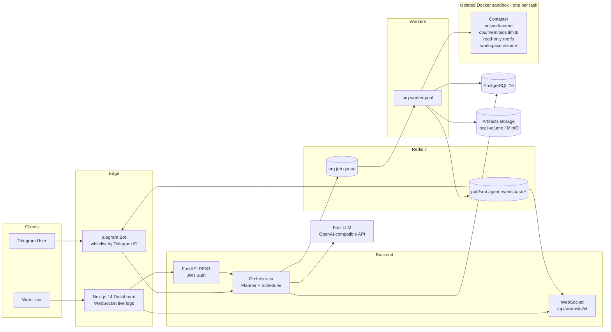

# Архитектура Agent Platform

## Компоненты

- **FastAPI** — REST API (JWT), WebSocket-стриминг логов, запуск оркестратора.
- **aiogram 3.x Bot** — приём задач, подтверждения опасных команд (human-in-the-loop).
- **Orchestrator** — планирование через LLM (Kimi), постановка шагов в очередь arq.
- **arq Workers** — выполнение шагов в изолированных Docker-песочницах, публикация событий.
- **Redis 7** — очередь задач (arq) и pub/sub канал событий `agent.events.task.*`.
- **PostgreSQL 16** — пользователи, задачи, шаги, аппрувы, события, артефакты.
- **Docker Sandbox** — контейнер на задачу: `network=none`, лимиты CPU/RAM/PIDs, read-only rootfs, примонтированный workspace.
- **Artifacts storage** — локальный volume (по умолчанию) или MinIO/S3.

## Диаграмма

## Поток выполнения задачи

1. Пользователь создаёт задачу (Telegram `/new_task` или `POST /api/tasks`).
2. Оркестратор вызывает LLM, получает JSON-план и сохраняет шаги в PostgreSQL.
3. Scheduler ставит job планирования / шаги в очередь arq (Redis).
4. Воркер поднимает песочницу задачи (или переиспользует), выполняет инструмент.
5. `run_shell` с опасной командой → создаётся approval, бот спрашивает подтверждение.
6. События публикуются в Redis pub/sub → WebSocket (Web) и бот (Telegram).
7. `finish_task` → задача завершена, артефакты собраны и отданы пользователю.

## Принятые решения

- **arq** вместо Celery: нативный asyncio-стек, меньше движущихся частей, те же Redis-очереди.
- **Один Docker-контейнер на задачу**, переиспользуется между шагами (shared workspace), удаляется по завершении/таймауту.
- **Mirrored path** для `/data/workspaces`: воркер и sandbox видят один и тот же абсолютный путь, поэтому bind-mount подкаталогов задачи работает через Docker socket.
- **События** пишутся и в PostgreSQL (история), и в Redis pub/sub (real-time).
- **Изоляция**: `network_mode=none`, `cap_drop=ALL`, `no-new-privileges`, лимиты памяти/CPU/PIDs; `http_request` выполняется воркером с whitelist хостов.
